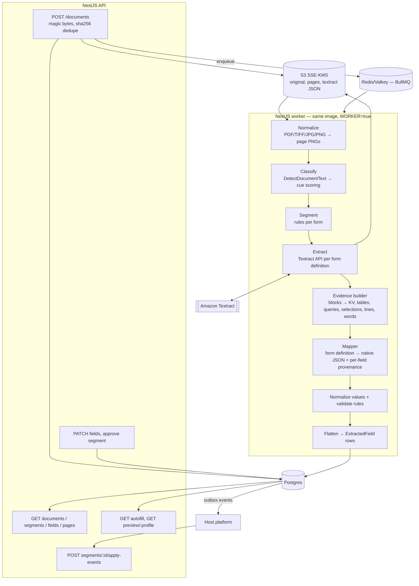

# Textract Document Extraction (IDP) — Technical Implementation Plan

> **For agentic workers:** REQUIRED SUB-SKILL: Use superpowers:subagent-driven-development (recommended) or superpowers:executing-plans to implement this plan task-by-task. Steps use checkbox (`- [ ]`) syntax for tracking.

**Goal:** A standalone NestJS service that accepts any PDF/image packet, splits it into forms, extracts every visible field with Amazon Textract, normalizes and validates it, stores it with form type, canonical key, confidence and page location, and exposes it to any host platform (plug-and-play) for preview, autofill and human-approved apply.

**Architecture:** Upload → S3 → rasterize to page PNGs → classify each page with cheap Textract text (`DetectDocumentText`) against a registry of form cues → group pages into segments → per segment, call the Textract API the form definition names (`AnalyzeDocument` / `AnalyzeID` / `AnalyzeExpense`) → convert Textract blocks into an engine-neutral **Evidence** model → a generic **mapper** fills the form's fields from declarative **form definitions** → normalize, validate, flatten into field rows → Postgres. Raw Textract JSON is kept, so a changed form definition can be re-mapped without paying Textract again.

**Tech Stack:** Node 24 LTS · NestJS 12 · TypeScript (strict) · Prisma 7.10 + PostgreSQL 16/17 · Zod 4 · `@aws-sdk/client-textract` / `client-s3` v3 · sharp · poppler `pdftoppm` · BullMQ 5 + Redis/Valkey · Jest + `@swc/jest`.

**Spec / source documents (read before starting):**
- [idp-workflow.md](../../../../idp-workflow.md) — **the confirmed workflow.** Textract is the default reader, classification uses registry cues, review is in the host platform, apply is human-only, GENERIC is a first-class outcome.
- [document-extraction-system-spec-1.md](../../../../document-extraction-system-spec-1.md) — first-phase spec. It is still the source for the form catalogs (§8), canonical dictionary (§9), normalization/validation rules (§12), flattener (§13), API (§14) and the eval metrics (§17). Its **LLM provider layer (§10–11) is replaced** by the Textract layer in this plan.
- [Multi-Form Document Extraction for NestJS…](../../../../Multi-Form%20Document%20Extraction%20for%20NestJS_%20CMS-1500,%20UB-04%20and%20B.md) — research. It contributes the storage principles: immutable raw output, EAV field rows, canonical plus native keys, and provenance (page, bbox, confidence).

**Status:** Plan complete. No code is written in this repo, and none will be: this repo holds the plan only. The build happens **inside the host ("main") project** through the one-shot prompt in [`09-host-implementation-prompt.md`](09-host-implementation-prompt.md). That prompt follows the host's own coding standards (§9). What is still open (decisions, AWS, test data) is tracked in [`STATUS.md`](STATUS.md).

**Agents start here:** read this file fully, then §9 (host adaptation) before any other file. The code snippets in 02–06 show the **behaviour and contracts** to build. They are not literal code to paste into a host whose stack differs.

---

## 1. Documents in this plan

| File | What it holds | Read when |
|---|---|---|
| `00-overview.md` (this) | Decisions, architecture, global constraints, repo layout, phase index, **§9 host adaptation rules** | First |
| [`STATUS.md`](STATUS.md) | What is done, what is left (decisions, AWS, test data, host prep), phase progress | Any time |
| [`01a-aws-walkthrough.md`](01a-aws-walkthrough.md) | **Guided** AWS setup: where to click, in what order, how to verify. Dev track (synthetic, ~1 h) and prod track (real PHI) | Before P2; whoever sets up AWS |
| [`01-aws-setup.md`](01-aws-setup.md) | Reference for every manual AWS step (BAA, AI opt-out, KMS, S3, IAM, VPC endpoints, quotas, alarms, budgets, async SNS/SQS role, fixture capture), with JSON policies and CLI | Looked up from 01a; ops owner |
| [`02-data-model.md`](02-data-model.md) | **Schema plan, written before any code.** Full Prisma schema, the reasons for each change from spec-1, indexes, migrations, retention | Before P0 |
| [`03-form-definition-dsl.md`](03-form-definition-dsl.md) | The extensibility core: the declarative form definition, canonical dictionary, rule library, and how to add a new form with no pipeline change | Before P3 |
| [`04-textract-layer.md`](04-textract-layer.md) | Textract client, call strategy, block-graph parser → Evidence model, field resolvers (query / key / region / checkbox / table / grid / layout), confidence, cost accounting | Before P2 |
| [`05-pipeline-and-api.md`](05-pipeline-and-api.md) | Stage contracts, classification and segmentation algorithm, normalization, validation, flattening, review, autofill, apply contract, integration events, REST API | Before P1 |
| [`06-phases-and-tasks.md`](06-phases-and-tasks.md) | The build: phases P0–P9 broken into tasks with files, interfaces, test cases and acceptance criteria | During the build |
| [`07-testing-and-eval.md`](07-testing-and-eval.md) | Fixture strategy (recorded Textract JSON), fakes, golden dataset, eval metrics and report | Before P2 |
| [`08-integration-scan-prompt.md`](08-integration-scan-prompt.md) | Read-only prompt: an agent scans a host project and writes an integration report (where and how IDP plugs in) | Fit check only, or as step 1 of 09 |
| [`../../../research/vendors/`](../../../research/vendors/README.md) | Research + implementation plans for **VLM Run** and **Meibel** as extra engines, a comparison with Textract, and the shared adapter (proposed D14) | Before deciding on a second engine |
| [`09-host-implementation-prompt.md`](09-host-implementation-prompt.md) | **The one prompt for building it in the host.** Scan (08) → host conventions map → checkpoint → build the requested scope task by task in the host's own style | When you start building |
| [`10-host-vlm-primary-prompt.md`](10-host-vlm-primary-prompt.md) | **Variant of 09 with VLM Run primary and Textract fallback (env-routed, D15).** Learns plan + research + POC, scans the host, writes DESIGN/ADR/ADAPTATION, checkpoint, builds slices S0–S6 | When VLM Run is the primary engine |

---

## 2. Decisions locked by this plan

| # | Decision | Why | Source |
|---|---|---|---|
| D1 | **Amazon Textract is the only extraction engine in v1.** | Already in the AWS account, HIPAA-eligible under the existing BAA, gives native checkbox state, per-value confidence and geometry. | Workflow §8.1 |
| D2 | **Classification = registry cues scored against `DetectDocumentText` lines**, in code. No Comprehend, no LLM. | A new form becomes a new cue list, with no training job. $0.0015/page. | Workflow §3.2, §8.2 |
| D3 | **Per-page synchronous Textract calls on our own rasterized PNG pages.** Async `StartDocumentAnalysis` is an optional path (P8) and not required. | Sync PDF/TIFF input is limited to 1 page and 10 MB. We rasterize anyway for preview, so every call is a single page. That removes the SNS/SQS plumbing from the critical path. | AWS set quotas |
| D4 | **The engine-neutral Evidence model sits between Textract and form mapping.** | Mappers never touch Textract blocks. A later engine (Bedrock Data Automation, a vision LLM) only has to produce Evidence. | Spec-1 rule 2, adapted |
| D5 | **Form definitions are pure data (declarative DSL), validated at boot.** Functions live only in a shared rule/resolver library, referenced by name. | A new form = one data file + fixtures, with no code changes. Definitions can later live in the DB (P9 option) without code change. | Spec-1 §7 and §19, made stricter |
| D6 | **Raw Textract responses are stored (S3, gzip JSON) and indexed in a `TextractCall` table.** | Audit, cost tracking, and **free re-mapping** after a definition changes. | New |
| D7 | **Textract reads the text; code normalizes it.** Dates, money, codes and names are normalized in TypeScript. | Deterministic and testable. | Spec-1 rule 4 |
| D8 | **Blank → null. Low confidence → flag, not a guess.** Below-threshold values are kept and flagged `low_confidence` → `NEEDS_REVIEW`. | Never invent data. | Spec-1 rule 5 |
| D9 | **Review and apply belong to the host platform.** This service exposes preview/autofill data and records apply events. It never writes `patient` or `claim`. | Human apply only. | Workflow §3.5, §8.4 |
| D10 | **No A2I, no Comprehend custom classifier, no Textract custom-queries adapters in v1.** Adapters are a documented upgrade path for CMS-1500/UB-04 accuracy. | Cost and complexity. A2I is closed to new customers. | Workflow §5.4 |
| D11 | **HEIC is not accepted in v1.** Textract accepts JPEG/PNG/PDF/TIFF. sharp's prebuilt binaries cannot decode HEVC-encoded HEIC. | Workflow capture formats are PDF/JPEG/PNG/TIFF. Add `heic-convert` later if phones become a channel. | Workflow §3.1 |
| D13 | **In a host repo, host conventions win on *how*. The plan wins on *what*.** The product invariants (§9.1) never change. Everything else adopts the host's existing patterns: framework version, ORM, validation, logger, folder layout, tests, style (§9.2). Nothing is invented where the host already has a pattern. | The code has to look like the rest of the host codebase so the host team can own it. The plan's stack is only the default for a standalone build. | User decision |
| D12 | **An independent product, plug-and-play in two ways:** (a) a standalone service that any platform calls over REST and consumes through outbox events, (b) an embeddable Nest dynamic module `IdpModule.forRoot({...})` that a larger NestJS project imports. Host-specific concerns (auth, entity links, doc-type labels, target DTO profiles, event delivery) sit behind ports with defaults, so no host name or host code lives in the core. | It can be reused across products and clients without forking. Host integration is configuration plus adapters, not changes to the core. See §8. | User decision |

---

## 3. Architecture



**Two runtime roles, one codebase:** `APP_ROLE=api` serves HTTP. `APP_ROLE=worker` consumes BullMQ queues. `APP_ROLE=all` does both (local dev). `PIPELINE_MODE=sync` runs stages inline in the request (P1–P7 dev and tests). `PIPELINE_MODE=queue` uses BullMQ (P8+).

---

## 4. Global Constraints

Every task implicitly includes these.

> **Host build:** the stack lines below (Runtime, Framework, DB/Prisma, Validation, Dependency budget, test tooling) are the **standalone defaults**. In a host repo, they are replaced by the host's equivalents through §9.2. Every other line here is a product invariant and applies everywhere.

- **Runtime:** Node `>=24` (LTS). TypeScript `strict: true`, `noUncheckedIndexedAccess: true`.
- **Framework:** `@nestjs/*` `12.x`. Do not mix major versions.
- **DB:** PostgreSQL `>=16`. Prisma `7.10.x` (pin exact; npm `latest` currently points at an 8.0 RC — **do not** use it). Prisma 7 rules: generator `provider = "prisma-client"`, explicit `output`, `moduleFormat = "cjs"`, connection URL in `prisma.config.ts` (not in `schema.prisma`), runtime connection through `@prisma/adapter-pg`.
- **Validation:** `zod` `4.x` for env config, DTOs and form-definition validation.
- **AWS SDK:** v3 modular clients only (`@aws-sdk/client-textract`, `@aws-sdk/client-s3`, `@aws-sdk/s3-request-presigner`). No v2 `aws-sdk`. Credentials always come from the default provider chain (ECS task role in AWS, IAM Identity Center SSO profile locally). **Never** read static access keys from env in code.
- **Dependency budget:** the packages above plus `sharp`, `@nestjs/bullmq`, `bullmq`, `ioredis` (BullMQ peer), `@nestjs/terminus`, `@nestjs/config`, `@nestjs/platform-express` (multer), `jest`, `@swc/jest`, `supertest`. Anything else needs a one-line justification in the PR.
- **System packages:** `poppler-utils` (`pdftoppm`, `pdfinfo`) in the Docker image and on dev machines.
- **Textract input:** JPEG/PNG/PDF/TIFF only; ≤10 MB per sync request; ≤10,000 px per side; text ≥15 px tall (≈8 pt at 150 DPI). Raster at **200 DPI** by default, and re-encode or downscale any page >9.5 MB.
- **Queries:** ≤**15 per page** on sync calls (30 async). The form-definition validator enforces this at boot.
- **PHI:** never log extracted values, Textract text, page images, or file names. Log IDs, statuses, counts, durations, Textract `RequestId` only. Enforced by a log-scan test (P9).
- **Tenancy:** every table carrying data has `tenantId`. Every query filters by it (Prisma client extension in P0, Postgres RLS in P9).
- **Immutability:** `TextractCall` and `Extraction.raw` are never updated after write. Reprocessing creates new rows.
- **No silent writes downstream:** this service never calls host-platform write APIs.
- **Form knowledge lives only in `src/forms/definitions/**`.** Adding a form must not touch pipeline, Textract, controller or schema code. If it does, fix the abstraction.
- **Every stage is idempotent**, takes IDs, and checks status before acting.
- **Tests never call AWS.** Unit and integration tests replay recorded Textract JSON. The live contract tests run only with `RUN_AWS_TESTS=true`, on synthetic data.
- **Synthetic data only** in fixtures, the golden set and console trials, until the BAA plus AI-services opt-out are confirmed (see `01-aws-setup.md` §1–2).
- When the spec is ambiguous: implement the simplest version and leave `// SPEC-QUESTION:` with the question.

---

## 5. Repository layout (target end state)

```
.
├─ docker/Dockerfile                      # node:24-bookworm-slim + poppler-utils
├─ docker-compose.yml                     # postgres:17, valkey:8 (dev only)
├─ prisma.config.ts                       # Prisma 7 config (datasource url, migrations path)
├─ prisma/schema.prisma
├─ prisma/migrations/**
├─ src/
│  ├─ main.ts                             # standalone mode: boots api | worker | all
│  ├─ app.module.ts                       # standalone mode: imports IdpModule.forRoot(fromEnv())
│  ├─ idp.module.ts                       # embeddable dynamic module: IdpModule.forRoot / forRootAsync
│  ├─ index.ts                            # public API barrel (module, ports, types, tokens)
│  ├─ ports/                              # host-integration seams (all have defaults)
│  │  ├─ auth.port.ts                     # resolve tenantId + userId from a request
│  │  ├─ event-sink.port.ts               # deliver outbox events (log | webhook | sqs | host callback)
│  │  ├─ target-profile.port.ts           # host DTO profiles for preview
│  │  ├─ doc-type-labels.port.ts          # host's document-type label list
│  │  └─ payer-directory.port.ts          # optional payer-name matching (enrich)
│  ├─ config/
│  │  ├─ env.schema.ts                    # Zod env schema (fail fast)
│  │  └─ config.module.ts
│  ├─ common/
│  │  ├─ logging/safe-logger.ts           # PHI-safe JSON logger
│  │  ├─ tenancy/tenant.guard.ts          # x-tenant-id / auth → request.tenantId
│  │  ├─ tenancy/prisma-tenant.extension.ts
│  │  ├─ errors/domain-errors.ts
│  │  └─ util/{hash.ts, magic-bytes.ts, paths.ts, text.ts}
│  ├─ prisma/prisma.service.ts            # PrismaClient + PrismaPg adapter
│  ├─ storage/
│  │  ├─ storage.port.ts                  # interface StoragePort
│  │  ├─ local.storage.ts
│  │  └─ s3.storage.ts
│  ├─ ingest/
│  │  ├─ documents.controller.ts          # POST /documents, GET /documents/:id, pages
│  │  └─ ingest.service.ts
│  ├─ pipeline/
│  │  ├─ pipeline.service.ts              # orchestrates stages (sync or queue)
│  │  ├─ rasterizer.service.ts            # file → page PNGs
│  │  ├─ classifier.service.ts            # pages → page classifications
│  │  ├─ segmenter.ts                     # pure function: classifications → segments
│  │  ├─ extractor.service.ts             # segment → TextractCall(s) → Evidence
│  │  ├─ mapping.service.ts               # Evidence + FormDefinition → MappedResult
│  │  ├─ finalizer.service.ts             # normalize, validate, flatten, persist
│  │  └─ queue/{queues.ts, processors/*.ts}  # P8
│  ├─ textract/
│  │  ├─ textract.client.ts               # thin wrapper over SDK, retries, metrics
│  │  ├─ textract-call.repository.ts      # TextractCall persistence + raw JSON storage
│  │  ├─ block-graph.ts                   # Block[] → indexed graph helpers
│  │  ├─ evidence.builder.ts              # AnalyzeDocument/ID/Expense → Evidence
│  │  ├─ queries.builder.ts               # definition → QueriesConfig
│  │  ├─ cost.ts                          # price table + estimator
│  │  └─ fake-textract.client.ts          # replay recorded JSON (tests)
│  ├─ evidence/
│  │  ├─ evidence.types.ts                # engine-neutral model
│  │  └─ geometry.ts                      # bbox math, reading order, nearest
│  ├─ forms/
│  │  ├─ dsl/form-definition.types.ts     # the DSL types
│  │  ├─ dsl/form-definition.schema.ts    # Zod validator for definitions
│  │  ├─ dsl/canonical-keys.ts            # canonical dictionary
│  │  ├─ registry/form-registry.ts        # load, validate, index, version
│  │  ├─ resolvers/*.resolver.ts          # query, key, region, checkbox, table, grid, layout, idField, expenseField
│  │  ├─ normalize/value-normalizers.ts   # date, money, code, name, phone, zip, state, boolean
│  │  ├─ rules/rule-library.ts            # NPI, ICD10, CPT, SUM_EQUALS, DATE_ORDER, ...
│  │  ├─ flatten/flattener.ts
│  │  └─ definitions/
│  │     ├─ generic.form.ts
│  │     ├─ cms1500.form.ts
│  │     ├─ ub04.form.ts
│  │     ├─ booking-sheet.form.ts
│  │     ├─ insurance-card.form.ts
│  │     ├─ us-id.form.ts
│  │     ├─ invoice.form.ts
│  │     └─ index.ts                      # export const DEFINITIONS = [...]
│  ├─ review/{fields.controller.ts, review.service.ts}
│  ├─ autofill/{autofill.controller.ts, autofill.service.ts, profiles/*.profile.ts}
│  ├─ integration/{outbox.service.ts, outbox.publisher.ts, apply-events.controller.ts}
│  └─ health/health.controller.ts
├─ scripts/
│  ├─ record-fixture.ts                   # call Textract once, save JSON fixture (synthetic only)
│  ├─ eval.ts                             # golden set → accuracy/cost report
│  └─ remap.ts                            # re-run mapping from stored TextractCalls
├─ test/
│  ├─ fixtures/textract/<FORM>/<case>/page-<n>.{analyze,detect}.json
│  ├─ builders/blocks.builder.ts          # hand-build tiny Textract Block graphs
│  └─ e2e/*.e2e-spec.ts
└─ test-data/<FORM>/<case>/{input.pdf, expected.json, notes.md}   # golden set
```

---

## 6. Phase index

Each phase ends with working, testable software. Do not start a phase until the previous phase's acceptance criteria pass. Full tasks are in [`06-phases-and-tasks.md`](06-phases-and-tasks.md).

| Phase | Feature delivered | Acceptance (summary) |
|---|---|---|
| **P0 Foundation** | Nest skeleton, embeddable `IdpModule` + host ports, Zod env, Prisma 7 schema + first migration, storage port (local), tenancy guard, safe logger, health | Boots; migration applies; bad env fails fast; `/health` green |
| **P1 Ingest + rasterize** | Upload, magic bytes, sha256 dedupe, PDF/TIFF/JPG/PNG → page PNGs, page image endpoint | 3-page PDF → 3 Page rows; multi-page TIFF works; duplicate upload returns same id |
| **P2 Textract layer** | Textract client, `TextractCall` persistence, block graph, Evidence builder, fixture recorder, fake client, cost estimator | Recorded fixture → Evidence with KV, tables, selections, queries; retries on throttling |
| **P3 Form DSL + GENERIC end-to-end** | DSL types + validator, registry, canonical dictionary, resolvers, mapper, normalizers, flattener, GENERIC form, `GET /fields` | Any file → field rows with labels, confidence, bbox; nothing crashes on unknown forms |
| **P4 CMS-1500** | Full definition (boxes 1–33, Box 24 grid), rule library, eval script | Golden CMS-1500 set runs through eval; NPI/ICD/total rules produce issues correctly |
| **P5 Classify + segment** | Cue scoring on `DetectDocumentText`, segmenter, staff hint bypass | Mixed PDF (2 CMS-1500 + 1 UB-04 + 1 unknown) → 4 correct segments |
| **P6 More forms** | UB-04, booking sheet, insurance card, US ID (`AnalyzeID`), invoice (`AnalyzeExpense`) | Each passes its eval; AnalyzeID/Expense routed by definition only |
| **P7 Review, autofill, integration** | Field review, approve, autofill by canonical key + subject match, target profiles (default patient/insurance/bundle preview; hosts add their own), outbox events, apply-event recording, signed page URLs | Reviewed value wins; profile preview returns host-shaped JSON; events emitted once |
| **P8 Queue + scale + reprocess** | BullMQ flows, Textract TPS limiter, retries, `remap` (free) and `reanalyze` (billed) reprocess, optional async Textract path | Upload returns 202; worker completes; remap creates new Extraction with zero Textract calls |
| **P9 Production hardening** | S3 + KMS storage, Postgres RLS, retention jobs, audit, PHI log-scan test, metrics/alarms, Docker/ECS deploy, optional DB-stored definitions | Log scan finds no PHI; RLS blocks cross-tenant reads; deploy runbook executed |

---

## 7. What "minimal change for a new form" means here

The core requirement is that new forms arrive with minimal change. This is the contract the design guarantees (details in `03-form-definition-dsl.md` §9):

1. Unknown form arrives → classified `GENERIC` → every key/value, checkbox, table and text line is still stored, with label, confidence and bbox. **No data is lost.**
2. To promote it: collect 5–10 synthetic samples, record fixtures (`scripts/record-fixture.ts`), write **one** definition file (cues + fields + canonical mappings + rules), add expected JSON, run `npm run eval -- --form NEW_FORM`.
3. Register it in `definitions/index.ts`. Boot validation checks query counts, canonical keys, rule names, path uniqueness.
4. `npm run remap -- --form-type GENERIC --to NEW_FORM --since 2026-11-01` re-maps old documents from their stored Textract JSON. This is free if the new definition uses only key/region/table/layout sources. Query sources need `reanalyze` (billed).

No new tables, endpoints, queues or Textract code. A new **rule** (e.g. a new checksum) or a new **resolver kind** is the only thing that needs code, and both are shared across all forms.

---

## 8. Plug-and-play: one product, any host platform

This service is a **product on its own**, not a feature of one client. No client names, client DTOs or client tables live in the core. A host platform (any EHR, billing system, practice-management app, or a large NestJS monolith) connects in one of two ways.

### 8.1 Mode A — standalone service (default)

```
Host platform ──REST──▶ IDP service (this repo, own DB, own S3 prefix)
Host platform ◀─events── outbox → webhook / SQS
```

- The host uploads with `POST /documents` and links documents to its own entities through `links: [{ entityType, entityId }]` (opaque strings, e.g. `patient:123`).
- The host reads previews from `GET /segments/:id/preview/:profile` and saves the data through **its own** APIs, then reports back with `POST /segments/:id/apply-events`.
- Auth: the host's JWT/OIDC, configured with `AUTH_JWKS_URL`, `AUTH_TENANT_CLAIM`, `AUTH_USER_CLAIM`. No code change.

### 8.2 Mode B — embedded Nest module

```ts
// In the host's NestJS app
import { IdpModule } from '@your-org/idp';

@Module({
  imports: [
    IdpModule.forRootAsync({
      inject: [HostConfig],
      useFactory: (cfg: HostConfig) => ({
        database: { url: cfg.idpDatabaseUrl },          // own schema/DB; never the host's tables
        storage: { driver: 's3', bucket: cfg.bucket, kmsKeyId: cfg.kmsKey, prefix: 'idp/' },
        textract: { region: cfg.region, tps: { analyze: 4, detect: 4, id: 1, expense: 1 } },
        pipeline: { mode: 'queue', redisUrl: cfg.redisUrl },
        http: { enabled: true, routePrefix: 'idp' },      // mount controllers under /idp, or false = services only
        ports: {
          auth: HostAuthAdapter,                          // implements AuthPort
          eventSink: HostEventBusAdapter,                 // implements EventSinkPort (in-process)
          targetProfiles: [hostPatientProfile, hostInsuranceProfile],
          docTypeLabels: ['BOOKING_SHEET', 'FACILITY_CLAIM', 'PHYSICIAN_CLAIM', 'ANESTHESIA_CLAIM', 'LETTER', 'OTHER'],
        },
        forms: { extra: [hostSpecificForm] },             // optional host-only form definitions
      }),
    }),
  ],
})
export class HostAppModule {}
```

Exported services for in-process use: `IdpDocumentsService` (ingest, get), `IdpReviewService`, `IdpAutofillService`, `IdpFormRegistry`.

**Mode B-inline (the usual case when building inside the "main" project):** the module's source lives in the host repo, in the host's module folder (e.g. `src/modules/idp/`, or `libs/idp/` in a monorepo), not in an npm package. It is written in the host's style (§9). The boundary rules stay the same: one self-contained module, host code calls only its public barrel (`index.ts`), the IDP owns its tables, ports for host concerns, and no imports from IDP internals elsewhere in the host. That way it can still be pulled out into a package later (Task 9.10).

### 8.3 Ports (host seams) and their defaults

| Port | Responsibility | Default (standalone) |
|---|---|---|
| `AuthPort` | request → `{ tenantId, userId }` | `x-tenant-id` header (dev) / JWT via JWKS (prod) |
| `EventSinkPort` | deliver outbox events | `log` / `webhook` (HMAC) / `sqs` |
| `TargetProfilePort` | host DTO shapes for preview | `default.patient`, `default.insurance`, `default.bundle` |
| `DocTypeLabelsPort` | allowed doc-type labels + mapping from formType/subtype | neutral list in §8.2 |
| `PayerDirectoryPort` | match the printed payer name to a host payer id | no-op (returns null) |
| `StoragePort` | object storage | `local` / `s3` |

### 8.4 Packaging rules (enforced from P0)

- **No host names in the core.** CI greps `src/` for a configurable deny-list of client names (`HOST_NAME_DENYLIST`) and fails if any appear. Host-specific code lives in the host repo or in `examples/<host>/`.
- The public API is only what `src/index.ts` exports. Everything else is internal and may change.
- The DB is **owned by the IDP** (own database or schema, own migrations). There are no foreign keys into host tables, only `DocumentLink` opaque ids.
- The S3 key prefix is configurable (`STORAGE_PREFIX`) so several hosts can share a bucket safely.
- Semantic versioning. Breaking changes to REST, events, the `index.ts` exports or the canonical dictionary need a major version bump.
- Publishing: the Docker image (Mode A) and an npm package `@your-org/idp` built from the same source (Mode B, P9 Task 9.10).

---

## 9. Building inside a host codebase (host conventions win)

This section governs every task in `06` when the code is written inside an existing project. An agent that follows `09-host-implementation-prompt.md` records how each rule applies in the host file `docs/idp/ADAPTATION.md`, then builds from that.

### 9.1 Product invariants — keep these in every host

1. **Engine:** Amazon Textract only in v1 (D1). An engine-neutral **Evidence** model sits between Textract output and form mapping (D4). Mappers never read Textract blocks.
2. **Forms are data.** Form definitions are declarative and validated at boot (D5). Adding a form touches only the definitions folder, fixtures and golden data (§7).
3. **Raw output is kept.** Every Textract response is stored as immutable gzip JSON and indexed in `TextractCall` (D6). Remap reuses it at no Textract cost.
4. **Data model semantics from `02`:** the same entities, columns, statuses and constraints. That includes one current extraction per segment, sha256 dedupe per tenant, `tenantId` on every row, EAV field rows with canonical and native keys plus provenance. Express them in the **host's** ORM and migration tool. The Prisma schema in `02` is the spec, not a required tool.
5. **Ownership:** the IDP owns its tables, in its own schema or under a table prefix that matches host naming. It has no foreign keys into host tables. `DocumentLink` stores opaque host ids.
6. **Human apply only.** The IDP never writes host domain entities (D9). The host saves through its own services, then records an apply event.
7. **Never invent data.** A blank field becomes null. Low confidence raises a flag and is never guessed (D8).
8. **PHI safety.** Logs carry IDs, statuses, counts and durations only. Until the BAA and AI opt-out are confirmed, only synthetic data is used.
9. **Tenancy:** every query is scoped by tenant.
10. **Idempotent stages** that take IDs and check status before acting.
11. **Tests never call AWS.** They replay recorded fixtures. Live tests are opt-in.
12. **Contracts:** the REST semantics and events in `05` §10–11, the canonical dictionary in `03` §3, and outbox payloads that carry IDs only. Route prefixes, the response envelope and error shape may follow host conventions, but the operations and their meaning stay.
13. **Credentials** come from the AWS default provider chain. No static keys in code or env files.
14. **Boundary:** IDP code lives in one module. Host code reaches it only through the public barrel, ports and REST.

### 9.2 Implementation choices — adopt the host's

| Plan default (standalone) | Find in the host | Rule |
|---|---|---|
| Node 24, NestJS 12 | `package.json`, `.nvmrc`, Dockerfile | Use the host's versions. **Never upgrade a host framework or runtime major as part of IDP work.** If a needed API is missing, use the host-version equivalent and record it. |
| Prisma 7 + `prisma.config.ts` | ORM, migration folder, naming (snake/camel, plural) | Use the host ORM (Prisma of any version, TypeORM, MikroORM, Knex…) and its migration flow. Keep the `02` semantics, including the partial unique index as raw SQL in a migration. |
| Zod env + DTOs | `class-validator`/`class-transformer`, Joi, Zod, config service | Use the host's validation and config loading. Keep fail-fast checks for the cross-field rules in `05` §12. |
| `SafeLogger` | Host logger (pino, winston, Nest Logger), redaction config | Use the host logger. Add the IDP allowlist or redaction **inside** it so invariant 8 holds. |
| `x-tenant-id` guard / `AuthPort` | Host auth guard, current-user decorator, tenant resolution | Implement `AuthPort` as a thin adapter over the host's existing guard and decorators. |
| BullMQ + Valkey | Host queue (BullMQ, SQS, Kafka, cron) | Use the host's queue lib if it has one. If not, use BullMQ and list it as a new dependency for approval. |
| `StoragePort` local/S3 | Existing `S3Service`, bucket config, key helpers | Wrap the host's S3 service in the `StoragePort` adapter. Keep the `02` §6 key layout under `STORAGE_PREFIX`. |
| `src/<area>/*.service.ts` layout | The host's module and folder layout, file naming, barrel use | Mirror an existing host feature module of similar size. Map every **Files:** path in `06` to it. |
| Jest + `@swc/jest`, `*.spec.ts` | Host test runner, file placement, factories and fixtures, e2e harness | Write the same test **cases** in the host's runner and style. Fixture JSON stays as data. |
| Error codes `{ code, message }` | Host exception filter and error envelope | Use the host envelope. Keep the IDP `code` strings inside it. |
| Conventional Commits | `git log`, CONTRIBUTING, PR template | Use the host's commit and branch style. |
| `@nestjs/swagger` or yaml | Host API-doc approach | Follow the host. |
| Lint, format | ESLint/Prettier/Biome config | Run the host's lint, typecheck and test commands after every task. |

### 9.3 Conflict rules

- **Evidence before adopting.** A host pattern counts only when it shows up in at least 2 existing places. Cite `path:line` in `ADAPTATION.md`. If two patterns compete, use the one in the most recently changed code and note the other.
- **Don't invent.** If the host already does something one way, do it that way, even if the plan shows another. Introduce a new pattern only when the host has none, and then use the plan default.
- **Invariants win over patterns.** If a host pattern would break §9.1 (for example, the host logger dumps request bodies), keep the invariant with the smallest local adaptation and record it.
- **New dependencies** need a one-line reason and the user's approval at the checkpoint.
- **No drive-by changes** to host code outside the IDP module and the agreed insertion points (08 report §4).
- **Unclear cases:** take the simplest option that keeps the invariants, leave a `SPEC-QUESTION` comment in the host's comment style, and list it in `ADAPTATION.md`.
