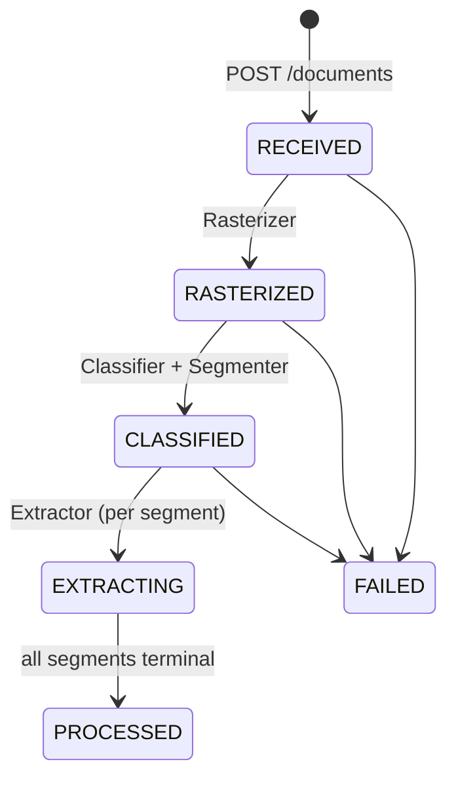

# 05 — Pipeline Stages, Algorithms, API and Integration

Every stage is a plain service method `run(id: string, opts?)`. It is idempotent, reads its inputs from the DB and storage, writes outputs, and moves a status forward. `PipelineService` chains stages inline (`PIPELINE_MODE=sync`) or as BullMQ jobs (`queue`, P8). Stage code is identical in both modes.



Segment lifecycle: `PENDING → EXTRACTING → EXTRACTED | NEEDS_REVIEW | FAILED`. Then review: `NEEDS_REVIEW → APPROVED | REJECTED`, and `EXTRACTED → APPROVED` (explicit approve, or `AUTO_APPROVE_CLEAN=true`).

---

## 1. Ingest — `IngestService.ingest(tenantId, file, opts)`

1. Read the multipart buffer (multer memory storage, `limits.fileSize = MAX_UPLOAD_MB`). Reject empty files.
2. Detect the type by **magic bytes** (`common/util/magic-bytes.ts`, no dependency):
   - `%PDF-` → `application/pdf`
   - `89 50 4E 47 0D 0A 1A 0A` → `image/png`
   - `FF D8 FF` → `image/jpeg`
   - `49 49 2A 00` / `4D 4D 00 2A` → `image/tiff`
   - anything else (incl. HEIC `ftypheic`) → `415 UNSUPPORTED_MEDIA_TYPE` with code `UNSUPPORTED_FILE`
3. PDF pre-checks with `pdfinfo` (poppler): encrypted → `422 PDF_ENCRYPTED`; pages > `MAX_PAGES` → `422 TOO_MANY_PAGES`; XFA forms are rejected by Textract, but we rasterize, so they are fine.
4. `sha256` of the bytes. Look up `(tenantId, sha256)`:
   - exists and `force` not set → add the `DocumentLink`s from `opts.links`, return the existing document (`200`, `deduplicated: true`).
   - exists and `force=true` → keep the same Document. `POST /documents/:id/reprocess` semantics apply.
5. `storage.put(keys.original(...))`, then create `Document(status=RECEIVED)` + links + `OutboxEvent('document.received')` in one transaction.
6. Kick off the pipeline (sync: await it; queue: enqueue `rasterize` and return `202`).

## 2. Rasterize — `RasterizerService.run(documentId)`

| Input | Command |
|---|---|
| PDF | `pdftoppm -r ${RASTER_DPI} -png -cropbox in.pdf <tmpdir>/p` (spawned with `execFile`, never a shell; 60 s timeout; tmpdir via `fs.mkdtemp`, removed in `finally`) |
| TIFF | `sharp(buf, { pages: -1 })` metadata → `pages` count → for each `i`: `sharp(buf, { page: i }).png()` |
| JPEG | `sharp(buf).rotate()` (EXIF orientation) `.png()` |
| PNG | `sharp(buf).png()` (strips metadata) |

For each page:
- If the long side > `MAX_IMAGE_LONG_SIDE` (default 3000; Textract's limit is 10,000) → resize, keeping the aspect ratio.
- Encode PNG `compressionLevel: 9`. If > 9.5 MB → re-encode as JPEG quality 90 and store it under a `.jpg` key (`Page.storageKey` always holds the real key and extension).
- Optional `RASTER_GRAYSCALE=false` (keep colour by default; red ink helps humans in review).
- Compute width, height, sha256, size → `Page` rows. Status `RASTERIZED`.

Idempotent: if Page rows already exist for the document, skip.

## 3. Classify — `ClassifierService.run(documentId)`

### 3.1 Bypass rules

| Condition | Result |
|---|---|
| `SEGMENTATION_MODE=single` | one segment, formType = hint ?? classify(first page) |
| `formTypeHint` set and `pageCount ≤ HINT_SINGLE_FORM_MAX_PAGES` | one segment = hint, `classifiedBy='hint'`, **no DetectDocumentText calls** |
| `formTypeHint` set and more pages | classify normally; the hint adds `+HINT_BOOST` (0.15) to that form's score on every page |

### 3.2 Per-page scoring (pure function `scorePage(lines, defs)`)

```
for each definition D (except GENERIC):
  raw = Σ cue.weight  for cues whose match appears in the page lines
        (region 'top' → only lines with bbox.top < 0.20; 'bottom' → top > 0.80)
  maxPositive = Σ positive cue weights
  score(D) = clamp(raw / maxPositive, 0, 1)
best = argmax score, tie → higher classifier.priority → definition order
if best.score < best.classifier.minScore → GENERIC (score kept for diagnostics)
evidence = { matchedCues, runnerUp }
```

Text for matching = `normalizeLabel(line.text)` per line, plus a page-wide concatenation for multi-line cues. Fuzzy matching per `TextMatch.fuzzy` absorbs OCR errors such as `HEALTH INSURANCE CLAIM F0RM`.

Persist on `Page`: `formType`, `classifierScore`, `classifierEvidence`, `continuesPrevious` (§4).

### 3.3 Why this is enough, and the upgrade path

Fixed claim forms carry unmistakable printed titles. Booking sheets, cards and letters vary, so they get lower `minScore`s and more cues. If the eval shows classification accuracy below 98% on the golden set, the upgrade path in order is: add or adjust cues → add negative cues → enable `CLASSIFIER_FALLBACK=bedrock` (P9 option: a Bedrock text-only call on the DetectDocumentText lines for pages scoring between 0.2 and `minScore`). The LLM fallback is an interface (`ClassifierFallback`) with a no-op default, so it can be added later without touching the scorer.

## 4. Segment — `segmenter.ts` (pure function)

Input: ordered `PageClass[] = { page, formType, score, lines }`. Output: `SegmentDraft[] = { formType, pageStart, pageEnd, score }`.

```
segments = []
for p in pages:
  D = def(p.formType); prev = last(segments)
  continues =
    prev && prev.formType == p.formType && (
      D.segmentation.mode == 'consecutive' && (p.score >= D.minScore || hasAny(p.lines, D.continuationCues))
      || D.segmentation.mode == 'pageOfTotal' && pageOf(p) == (x, y) && x > 1 && prev.lastPageOf == (x-1, y)
    )
  // GENERIC page between two same-form 'consecutive' pages with a continuation cue → absorbed into previous
  if !continues && p.formType == 'GENERIC' && prev && def(prev.formType).segmentation.mode == 'consecutive'
       && hasAny(p.lines, def(prev.formType).segmentation.continuationCues) → continues = true (formType stays prev's)
  if continues && (prev.pageEnd - prev.pageStart + 1) < (D.segmentation.maxPages ?? ∞): prev.pageEnd = p.page
  else: segments.push(new segment)
```

| Form | Mode | Rule |
|---|---|---|
| CMS1500 | `perPage` | every page is its own claim (spec-1 §6.3) |
| UB04 | `pageOfTotal` | regex `PAGE\s*(\d+)\s*OF\s*(\d+)` on FL23 lines groups 1/2, 2/2 … |
| BOOKING_SHEET | `consecutive` | continuation cues, e.g. `PAGE 2`, `CONTINUED`, the sheet's header text |
| INSURANCE_CARD | `consecutive`, `maxPages: 2` | front + back |
| US_ID | `consecutive`, `maxPages: 2` | front + back → one `AnalyzeID` call |
| INVOICE | `consecutive` | |
| GENERIC | `consecutive` | adjacent GENERIC pages merge into one segment |

Then create `Segment` rows (`ordinal` 1..n, `classifiedBy='cues'`), set `docTypeLabel` from the definition (subtype refines it after extraction), and set Document `CLASSIFIED`.

## 5. Extract — `ExtractorService.run(segmentId, { force? })`

1. Load the segment, its pages and definition `D` (`registry.get(formType)`; unknown → GENERIC). Set segment `EXTRACTING`.
2. By `D.engine.api`:
   - `AnalyzeDocument`: for each page in range → `textractCalls.getOrCall(page, 'AnalyzeDocument', features, buildQueries(D))`. Pages run concurrently up to `EXTRACT_PAGE_CONCURRENCY` (default 4), under the TPS limiter.
   - `AnalyzeID`: one call with up to 2 page inputs.
   - `AnalyzeExpense`: one call per page.
3. Build `Evidence` from all call responses (`EvidenceBuilder`).
4. `MappingService.map(D, evidence)` → `MappedResult`.
5. Hand off to `FinalizerService.run(segmentId, mapped, callIds, mode)`.

`getOrCall` re-uses a stored response when `requestHash` matches (§04-1). With `force`, it calls again and creates a new `TextractCall`.

## 6. Map — `MappingService.map(def, evidence): MappedResult`

```ts
export interface MappedResult {
  native: Record<string, unknown>;          // skeleton filled; includes _unmapped[]
  provenance: Record<string, Provenance>;   // per concrete native path
  meta: { unreadable: string[]; uncertain: string[]; notFound: string[]; notes: string | null };
}
export interface Provenance { source: string | null; confidence: number | null; page: number | null; bbox: BBox | null; label?: string }
```

Order: checkbox groups (they claim selections first) → fields → groups → split parsers → unmapped capture. Pages in scope = the segment's pages.

`MAPPER_VERSION = '1'` is exported here and bumps on any behaviour change in resolvers or normalizers.

## 7. Finalize — `FinalizerService.run(...)`

1. `normalized = normalizeValues(D, mapped.native)` (per `valueType` from the definition, with the `03` §4.1 table). Normalizer failures add flag `validation_error` on that path.
2. `issues = runRules(D, normalized)` (field rules + form checks) → `ValidationIssue[] { path, code, message, severity }`.
3. `subtype = resolveSubtype(D, normalized, document.docTypeLabel)`. `subjectHints = pick(D.subjectHints, normalized)`.
4. `rows = flatten(D, normalized, mapped, issues)` (§8).
5. Status: any `error` issue **or** any flag in `{low_confidence, uncertain, unreadable, multi_selected, validation_error, not_found}` → `NEEDS_REVIEW`; else `EXTRACTED`. GENERIC segments → always `NEEDS_REVIEW` unless `GENERIC_AUTO_EXTRACTED=true`.
6. **One transaction:**
   ```ts
   await prisma.$transaction(async tx => {
     await tx.extraction.updateMany({ where: { segmentId, isCurrent: true }, data: { isCurrent: false } });
     const ex = await tx.extraction.create({ data: { ...meta, raw: mapped.native, normalized, provenance, validationIssues: issues, isCurrent: true } });
     await tx.extractedField.createMany({ data: rows.map(r => ({ ...r, extractionId: ex.id, tenantId, formType })) });
     await tx.segment.update({ where: { id: segmentId }, data: { status, subtype, docTypeLabel, subjectHints } });
     await tx.outboxEvent.create({ data: { type: status === 'NEEDS_REVIEW' ? 'segment.needs_review' : 'segment.extracted', aggregateId: segmentId, payload: { documentId, segmentId, formType, status } } });
   });
   ```
7. If every segment of the document is terminal → Document `PROCESSED` + `OutboxEvent('document.processed')`.

## 8. Flatten — `flatten(def, normalized, mapped, issues): FieldRow[]`

Spec-1 §13 algorithm, adapted:

- Walk `normalized`, skipping `_unmapped`. Primitive arrays (e.g. `modifiers`) are one row whose `normalizedValue` is the array.
- `nativePattern = path.replace(/\[\d+\]/g, '[*]')`; `groupIndex` = first index; `groupName` = `GroupDef.name`.
- `canonicalKey` comes from an index built at registry load: `pattern → canonical` (fields, `split.into` inherit nothing unless they have their own canonical, columns use `group.path + '[*].' + column.path`, checkbox groups).
- `valueType` from the same index.
- `rawValue` = `mapped.native` at the same path, stringified. `normalizedValue` = normalized leaf.
- `confidence/page/bbox/source/label` from `mapped.provenance[path]`.
- `flags` = union of: meta lists containing the path; issue paths with `error`/`warning` → `validation_error` (error only); `low_confidence`/`multi_selected` from the mapper.
- **Emit null leaves too** (blank is information).
- `_unmapped[i]` → `nativePath = '_unmapped[i]'`, `nativePattern = 'generic:' + slug(label)`, `canonicalKey = null`, `groupName = 'unmapped_' + kind`, `source='generic'`.

`slug(label) = normalizeLabel(label).toLowerCase().replace(/ /g, '-').slice(0, 80)`.

## 9. Review, approval, autofill, profiles

### 9.1 Review

- `PATCH /fields/:id { value, reviewer }` → validates `value` against the field's `valueType` (with the same normalizer), sets `reviewedValue/By/At`, removes the `low_confidence`/`uncertain`/`not_found`/`multi_selected` flags (keeps `validation_error` unless the new value passes the rule), and appends a `FieldReviewEvent`.
- `POST /fields/:id/confirm { reviewer }` → accept the current value as is (clears review flags, `action='confirm'`).
- `POST /segments/:id/approve { reviewer }` → `409` if any field still has a review flag or there are unresolved `error` issues (pass `force: true` to override; recorded). Sets `APPROVED`, emits `segment.approved`.
- `POST /segments/:id/reject { reviewer, reason }` → `REJECTED`.
- `PATCH /segments/:id { formType }` (manual reclassify) → `classifiedBy='manual'`, triggers `remap` if stored calls cover the needed features, else `reanalyze`.

### 9.2 Autofill — `GET /autofill`

`?keys=patient.name.last,insured.id&match[patient.dob]=1984-03-12&match[patient.name.last]=DOE[&documentId=…|&link=patient:123][&approvedOnly=true]`

- Scope: `link=patient:123` (via `DocumentLink`) is the normal host-platform case. `match[...]` pairs are an alternative (spec-1 §14 SQL, with `isCurrent`, using **effective value** and lowercase/trim compare for names).
- Per key: latest effective non-null value. Ordering: reviewed first → fewer flags → `APPROVED` segments first → newer.
- Response per key: `{ value, fieldId, segmentId, documentId, formType, confidence, flags, reviewed }`. Multi-valued keys (`claim.diagnosis_codes`, `line.*`) return arrays grouped by `segmentId` + `groupIndex`.

### 9.3 Target profiles (host-shaped preview) — `GET /segments/:id/preview/:profile`

A profile is **declarative**: Host DTO field → canonical key(s) + transform. It lives in `src/autofill/profiles/*.profile.ts`, so host DTO changes stay out of form definitions.

```ts
export const defaultPatientProfile: TargetProfile = {
  id: 'default.patient',
  fields: {
    firstName:   { key: 'patient.name.first' },
    lastName:    { key: 'patient.name.last' },
    middleName:  { key: 'patient.name.middle' },
    dateOfBirth: { key: 'patient.dob' },                 // ISO date string
    gender:      { key: 'patient.sex', map: { M: 'MALE', F: 'FEMALE' } },
    address1:    { key: 'patient.address.street' },
    city:        { key: 'patient.address.city' },
    state:       { key: 'patient.address.state' },
    zip:         { key: 'patient.address.zip' },
    phone:       { key: 'patient.phone' },
  },
};
// default.insurance: payer.name, insured.id, insured.group_number, insured.name.*, insured.relationship, insured.dob
// default.bundle:    line.service_date_from, line.cpt_hcpcs, line.modifiers, claim.diagnosis_codes, facility.name, provider.*.npi
```

Response: `{ profile, values: { firstName: { value, fieldId, confidence, flags } … }, missing: [...] }`. The New Patient screen prefills **empty** inputs only (Workflow §7). That is a client rule, documented in the API response as `prefillPolicy: 'empty-only'`.

`// SPEC-QUESTION:` each host platform confirms its own DTO field names and registers its own profile (e.g. `acme.patient`) before go-live. The `default.*` profiles are a neutral reference shape.

### 9.4 Apply events — `POST /segments/:id/apply-events`

The host platform calls this **after** it has saved the values through its own APIs: `{ profile, targetType, targetId, appliedKeys: [{ canonicalKey, fieldId, value }], appliedBy }`. The service stores an `ApplyEvent` and emits `segment.applied`. Nothing else changes, because this service never writes to the host platform.

## 10. Integration — outbox and events

- `OutboxEvent` rows are written in the same transaction as the state change.
- `OutboxPublisher` (worker role, every `OUTBOX_POLL_MS` = 2000) selects unpublished rows `FOR UPDATE SKIP LOCKED LIMIT 50`, delivers them, and sets `publishedAt` (or `attempts++`, `lastError`, exponential delay).
- Delivery goes through `EventSinkPort` (`00` §8.3). Built-in adapters (env `OUTBOX_DRIVER`): `log` (dev), `webhook` (HMAC-SHA256 signature header `x-idp-signature`, secret `OUTBOX_WEBHOOK_SECRET`), `sqs` (P9).
- **Payloads carry IDs and statuses only.** The host platform fetches data through the API. Consumers must be idempotent on `event.id`.

| Event | When |
|---|---|
| `document.received` | ingest |
| `document.processed` | all segments terminal |
| `document.failed` | rasterize/classify failure |
| `segment.extracted` / `segment.needs_review` | finalize |
| `segment.approved` / `segment.rejected` | review |
| `segment.applied` | apply event recorded |

## 11. REST API (all routes need the `x-tenant-id` header from the auth guard; JSON; errors `{ code, message }`)

| Method | Path | Purpose |
|---|---|---|
| `POST` | `/documents` | multipart `file`; fields `source`, `formTypeHint`, `docTypeLabel`, `links` (JSON `[{entityType, entityId}]`), `force`. Sync → `201` + full summary; queue → `202 { documentId }`; dedupe → `200` |
| `GET` | `/documents/:id` | status, pages, segments (formType, subtype, status, score), cost total, issues count |
| `GET` | `/documents?link=patient:123&status=…` | list for the Documents tab |
| `GET` | `/documents/:id/pages/:n/image` | `302` to a presigned S3 GET (5 min) or a stream in local mode |
| `GET` | `/documents/:id/segments/:segId/data` | `{ formType, formVersion, normalized, raw, provenance, meta, issues }` (current extraction) |
| `GET` | `/documents/:id/fields` | paged rows; filters `canonicalKey`, `formType`, `flag`, `segmentId`, `source` |
| `POST` | `/documents/:id/reprocess` | `{ from: 'rasterize'|'classify'|'extract', mode: 'remap'|'reanalyze', formType? }`. `reanalyze` returns an estimated cost and needs `confirm: true` |
| `PATCH` | `/segments/:id` | manual `formType` change |
| `POST` | `/segments/:id/approve` · `/reject` | review outcome |
| `PATCH` | `/fields/:id` · `POST /fields/:id/confirm` | field review |
| `GET` | `/segments/:id/preview/:profile` | host-shaped prefill |
| `POST` | `/segments/:id/apply-events` | record apply |
| `GET` | `/autofill` | canonical-key lookup |
| `GET` | `/forms` | registered forms: id, version, displayName, fields (path, label, type, canonical), canonical dictionary |
| `GET` | `/health` · `/health/ready` | liveness / readiness (DB, storage, Redis in queue mode) |

DTOs are validated with Zod (`ZodValidationPipe`). OpenAPI is generated with `@nestjs/swagger` *(dependency budget exception: justified for host-platform clients)*, or a hand-written `openapi.yaml`. Pick one in P7.

## 12. Configuration (`src/config/env.schema.ts`, Zod, fail fast)

```bash
# App
APP_ROLE=all                     # api | worker | all
PORT=3000
PIPELINE_MODE=sync               # sync | queue
DATABASE_URL=postgresql://...
REDIS_URL=redis://localhost:6379 # queue mode
LOG_LEVEL=info

# Ingest / raster
MAX_UPLOAD_MB=25
MAX_PAGES=50
RASTER_DPI=200
MAX_IMAGE_LONG_SIDE=3000
RASTER_GRAYSCALE=false

# Classification / segmentation
SEGMENTATION_MODE=per-page       # per-page | single
HINT_SINGLE_FORM_MAX_PAGES=2
HINT_BOOST=0.15
CLASSIFIER_FALLBACK=none         # none | bedrock (P9 option)

# Extraction
DEFAULT_MIN_CONFIDENCE=80
GENERIC_WITH_TABLES=false
GENERIC_AUTO_EXTRACTED=false
AUTO_APPROVE_CLEAN=false
EXTRACT_PAGE_CONCURRENCY=4

# Textract
AWS_REGION=us-east-1
TEXTRACT_MODE=sync               # sync | async
TEXTRACT_MAX_ATTEMPTS=6
TEXTRACT_TPS_ANALYZE=4
TEXTRACT_TPS_DETECT=4
TEXTRACT_TPS_ID=1
TEXTRACT_TPS_EXPENSE=1
TEXTRACT_PRICE_OVERRIDES=        # JSON, optional
TEXTRACT_SNS_TOPIC_ARN=          # async only
TEXTRACT_SNS_ROLE_ARN=
TEXTRACT_DONE_QUEUE_URL=

# Storage
STORAGE_DRIVER=local             # local | s3
STORAGE_LOCAL_DIR=./storage
S3_BUCKET=
S3_KMS_KEY_ID=
STORAGE_PREFIX=                  # optional, lets several hosts share one bucket
PRESIGN_TTL_SECONDS=300

# Auth (host platform)
AUTH_MODE=header                 # header (dev) | jwt
AUTH_JWKS_URL=
AUTH_TENANT_CLAIM=tenant_id
AUTH_USER_CLAIM=sub

# Packaging guard
HOST_NAME_DENYLIST=              # comma-separated client names that must never appear in src/

# Compliance
PHI_MODE=false
PHI_BAA_CONFIRMED=false
AI_OPTOUT_CONFIRMED=false
PAGE_IMAGE_RETENTION_DAYS=30

# Integration
OUTBOX_DRIVER=log                # log | webhook | sqs
OUTBOX_WEBHOOK_URL=
OUTBOX_WEBHOOK_SECRET=
OUTBOX_POLL_MS=2000
```

Cross-field rules (Zod `superRefine`): `PIPELINE_MODE=queue` ⇒ `REDIS_URL`; `STORAGE_DRIVER=s3` ⇒ `S3_BUCKET` + `S3_KMS_KEY_ID`; `TEXTRACT_MODE=async` ⇒ the three async vars; `PHI_MODE=true` ⇒ `STORAGE_DRIVER=s3` + both `*_CONFIRMED=true`; `OUTBOX_DRIVER=webhook` ⇒ URL + secret ≥32 chars; `AUTH_MODE=jwt` ⇒ `AUTH_JWKS_URL`; `PHI_MODE=true` ⇒ `AUTH_MODE=jwt`.

## 13. Observability (no PHI)

- **Logs:** JSON lines `{ ts, level, msg, tenantId, documentId?, segmentId?, stage, durationMs, awsRequestId?, code? }`. The `SafeLogger` drops any key outside an allowlist.
- **Metrics** (log-based EMF, or `prom-client` behind the budget-exception rule): `idp_pages_total{api}`, `idp_textract_cost_usd_total{api}`, `idp_stage_duration_ms{stage}`, `idp_segments_total{formType,status}`, `idp_textract_errors_total{api,code}`, `idp_review_queue_size`.
- **Tracing:** an optional OpenTelemetry SDK (P9) with span attributes restricted to IDs.
