# IDP document workflow — how we think about it, how we use it

**Document type:** Workflow and thinking (not an implementation plan)
**Date:** 2026-10-27
**Grounding:**
- [Amazon Textract](https://aws.amazon.com/textract/)
- [Amazon Textract pricing](https://aws.amazon.com/textract/pricing/) — list rates used in §9 (checked 2026-10-27)
- [AWS insurance IDP Part 1](https://aws.amazon.com/blogs/machine-learning/part-1-intelligent-document-processing-with-aws-ai-services-in-the-insurance-industry/) — capture, classify, extract
- [AWS insurance IDP Part 2](https://aws.amazon.com/blogs/machine-learning/part-2-intelligent-document-processing-with-aws-ai-and-analytics-services-in-the-insurance-industry/) — enrich, review, insights
- [AWS IDP sample — insurance notebooks](https://github.com/aws-samples/aws-ai-intelligent-document-processing/tree/main/industry/insurance)
- [AWS IDP workshop — insurance use case](https://catalog.workshops.aws/intelligent-document-processing/en-US/03-industry-use-case/insurance-use-case)
- Typical host-platform hooks: a New Patient PDF upload, a Documents tab, a patient-document record, S3

This file is the **intended workflow**. It does not prescribe modules, migrations, or a build schedule. Companion research stays in the other files in this folder.

---

## 0. What we are trying to do

Staff already drop paperwork onto a patient (or will). The host platform already stores the file in S3. Today nothing is read from the scan.

We want:

1. Accept **any** packet — not only HCFA / UB-04.
2. Split a mixed PDF into the forms inside it.
3. Pull every visible field.
4. Show a preview on the New Patient form and Documents tab.
5. Write to `patient` / insurance / bundle **only after a human applies it**.

Unknown layouts are not errors. They are still extracted as generic label/value pairs and can be promoted later.

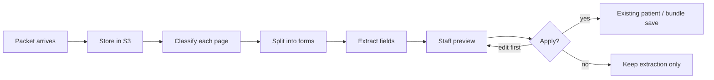

---

## 1. How AWS thinks about this (we keep the stages)

The [insurance Part 1](https://aws.amazon.com/blogs/machine-learning/part-1-intelligent-document-processing-with-aws-ai-services-in-the-insurance-industry/) pipeline is the mental model. A claim is not one form. It is a **packet** that must pass checkpoints before anyone trusts the data.

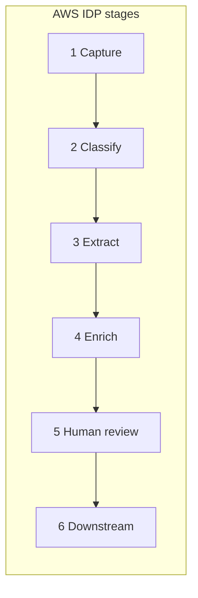

| Stage | What AWS does in the blog | What that means for this project |
|---|---|---|
| Capture | Fax / email / portal → S3 (PDF, JPEG, PNG, TIFF) | New Patient PDF, Documents tab, later inbox. S3 already exists. |
| Classify | Textract text + **trained Comprehend** class list | Detect CMS-1500, UB-04, booking sheet, card, DL, invoice, letter, unknown. Prefer a **registry of form cues**, not a frozen trained class list, so a new form does not need a new training job. |
| Extract | Textract `FORMS` / `TABLES` / `AnalyzeID` / `AnalyzeExpense` | Named fields, tables, checkboxes, IDs, invoices. This is the default engine. |
| Enrich | Comprehend entities / medical (Part 2) | Normalize dates and money; check NPI / ICD / CPT shape; match payer name to the `payer` table. |
| Review | Amazon A2I in the 2022 blog | **In-app review.** A2I entered maintenance in July 2026 and does not take new customers. Host-platform staff already sit on the patient record. |
| Downstream | Adjudication / analytics | Autofill preview → existing patient and bundle save. Payment engine is not in this workflow. |

AWS’s own sample packet is the pattern we expect: **CMS-1500 + insurance ID + driver’s license + invoice in one upload**. A typical packet looks the same: booking sheet + physician HCFA + facility UB-04 + card.

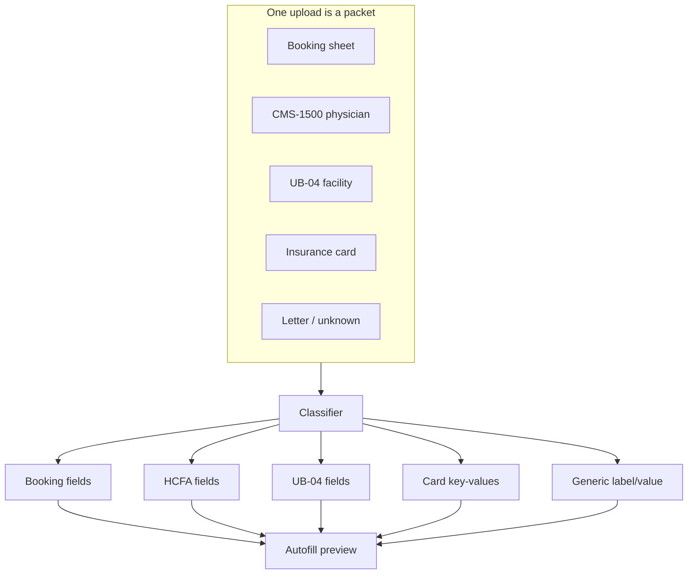

---

## 2. How it plugs into a host platform

We do not invent a new product surface. We finish the ones that are already stubbed.

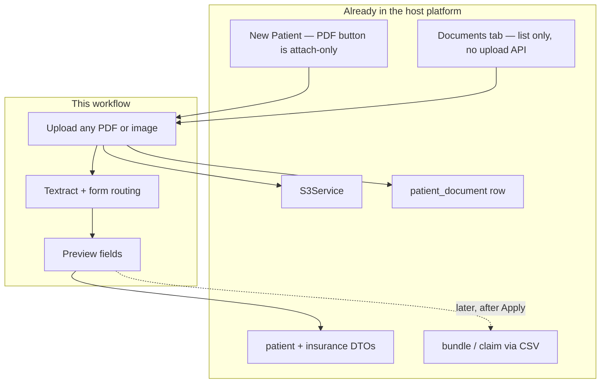

What we use as-is:

- S3 and the AWS account / BAA boundary
- Patient demographics and insurance as the autofill targets
- Document type labels already in the UI: Booking sheet, Facility claim, Physician claim, Anesthesia claim, Letter, Other
- Auth, audit, permissions

What we do **not** put in this workflow:

- Payment bifurcation / rule engine
- CSV claim upload
- Downstream billing/clearinghouse push (runs in the host after the user saves the patient)
- Silent writes to `patient` or `claim`

---

## 3. The working pipeline (how we think it runs)

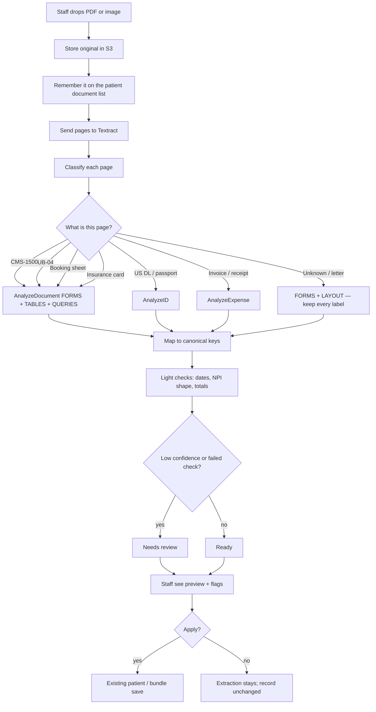

### 3.1 Capture

Channels we care about now: New Patient PDF, Documents tab. Later: fax / email inbox.

Formats: PDF, JPEG, PNG, TIFF (fax). Multi-page is normal.

Store once. Deduplicate by file hash on the same patient so a re-drop does not spawn a second job unless staff force it.

### 3.2 Classify

AWS Part 1 trains Comprehend on Textract text, then scores each page (`Doc_name` → confidence). That is good when the class list is frozen.

We want new forms without a training cycle. So classification is:

1. Get text / layout from Textract (cheap, same account).
2. Match printed titles and cues from a **form registry** (for example: “HEALTH INSURANCE CLAIM FORM”, “UB-04”, “FORM 1500 (02-12)”).
3. If nothing matches or confidence is low → `GENERIC`. Never drop the page.

Comprehend custom classification stays an **optional later upgrade** if one sender’s packet mix is stable and we want a hosted classifier. It is not the thing that makes a new form possible.

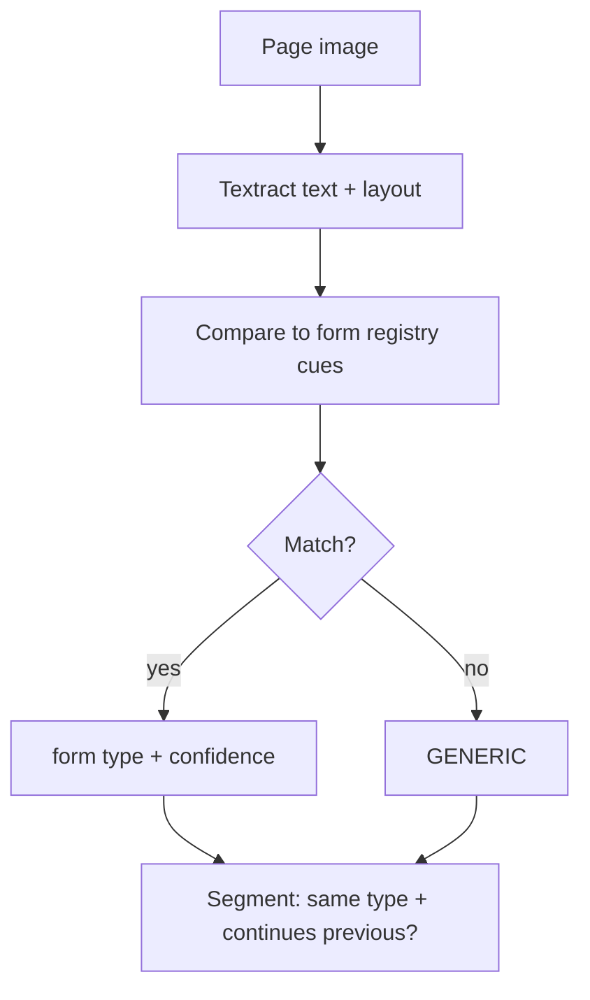

**Segment rules we already believe:**

- CMS-1500: each page is usually its own claim (six service lines, own totals).
- UB-04: group pages that share “PAGE __ OF __” on FL23.
- Booking sheet: consecutive pages of the same type that continue.
- Mixed packet → many segments, one upload.

### 3.3 Extract — pick the Textract API by document kind

This is the same split as the [insurance sample](https://github.com/aws-samples/aws-ai-intelligent-document-processing/tree/main/industry/insurance) and the blog.

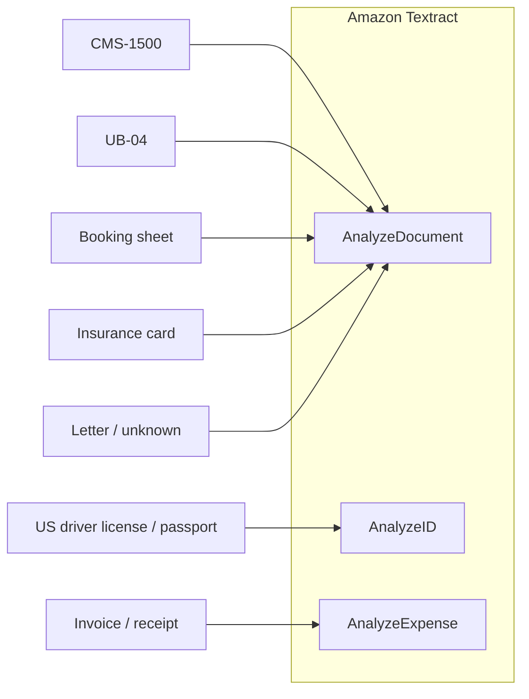

| Document | Textract call | Why |
|---|---|---|
| CMS-1500 | `AnalyzeDocument` `FORMS` + `TABLES` + `QUERIES` | Key-values, Box 24 grid, named queries for Box 1a / 2 / 3 / 21 / 28, `SELECTION_ELEMENT` for Box 1 / 6 / 10 |
| UB-04 | same | FL boxes + revenue-line table |
| Booking sheet | `FORMS` + `TABLES` + `LAYOUT` | No fixed grid; keep leftover labels |
| Insurance card | `FORMS` | Layouts differ by payer; keys still print |
| US DL / passport | `AnalyzeID` | Implied fields (name, address) plus printed keys; no template |
| Invoice | `AnalyzeExpense` | Vendor, totals, line items; unknown keys become `OTHER` |
| Anything else | `FORMS` + `LAYOUT` | Generic capture — this is how “all forms” works |

Queries are how we ask for **our** names (“Insured ID in Box 1a”) instead of hoping the printed key matches. That is the portable piece when a new form arrives: add queries + cue text, not a new pipeline.

### 3.4 Enrich (light, in our app)

Part 2 uses Comprehend for entities and fraud-style analytics. For v1 we only need:

- Dates and money into one shape
- NPI / ICD / CPT / revenue-code format checks
- Payer string → existing `payer` row when it matches
- Sum of line charges vs printed total → flag, do not block storage

### 3.5 Review and apply

Staff stay in the patient workspace. Low-confidence fields, checkbox disagreements, and failed checks go to **Needs review**. Apply is explicit.

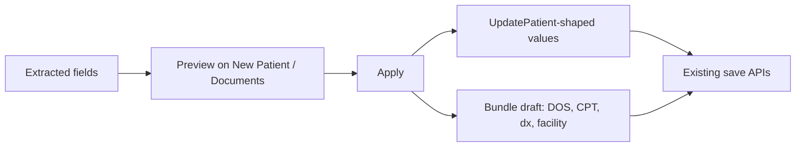

Canonical keys (form-independent meaning) are what autofill asks for. CMS-1500 Box 2, UB-04 FL8b, and a booking-sheet “Patient Name” all become `patient.name.*`.

---

## 4. How we use the AWS insurance sample (under the hood)

The sample is a **lab**, not something we drop into NestJS. Notebooks are Python. This project is NestJS. We copy the *API sequence and packet idea*, not the notebook runtime.

Repo: [aws-samples/aws-ai-intelligent-document-processing](https://github.com/aws-samples/aws-ai-intelligent-document-processing)  
Insurance path: [industry/insurance](https://github.com/aws-samples/aws-ai-intelligent-document-processing/tree/main/industry/insurance)  
Guided version: [workshop — insurance use case](https://catalog.workshops.aws/intelligent-document-processing/en-US/03-industry-use-case/insurance-use-case)

The workshop lists four notebooks. We use each one as a question:

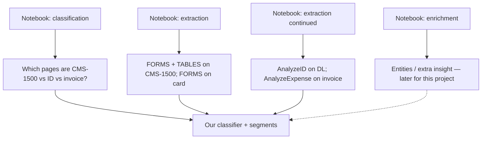

**How we actually run the sample (to learn, on synthetic packets only):**

1. Clone the repo. Open `industry/insurance`.
2. Use an AWS account that already has a BAA if any document is real PHI. For learning, fill blank CMS-1500 / UB-04 PDFs with fake data.
3. Walk the classification notebook: Textract text → class scores. Note the class names they chose. Ours will be wider (`BOOKING_SHEET`, `GENERIC`, …).
4. Walk the extraction notebook: `AnalyzeDocument(FeatureTypes=['FORMS','TABLES'])` on CMS-1500. This is the call we reuse.
5. Walk the continued notebook: `AnalyzeID` and `AnalyzeExpense`. Same APIs, different document kinds.
6. Keep the returned key-value dicts as the **shape we map** into the project's canonical keys. Do not keep the notebook as a service.

The IDP service then calls the same Textract APIs with the AWS SDK v3 (`@aws-sdk/client-textract` next to the S3 client), in the project's AWS account.

---

## 5. How to set up Amazon Textract

Product page: [aws.amazon.com/textract](https://aws.amazon.com/textract/).  
Getting started: [Textract getting started](https://docs.aws.amazon.com/textract/latest/dg/getting-started.html).  
Console demo (safe for non-PHI): [console.aws.amazon.com/textract](https://console.aws.amazon.com/textract/).

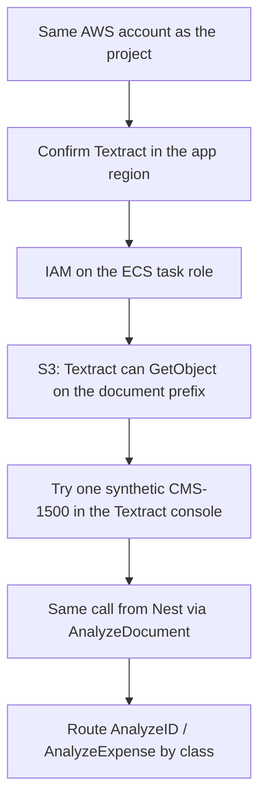

### 5.1 Account and region

The project runs on AWS (ECS, S3, RDS). Textract is used **in that account**, in the same region as the document bucket, so objects do not cross regions.

Textract has been [HIPAA eligible](https://aws.amazon.com/about-aws/whats-new/2019/10/amazon-textract-is-now-a-hipaa-eligible-service/) since 2019. Real patient packets stay under the existing BAA. Learning and golden-set work uses synthetic data.

### 5.2 IAM (ECS task role, not a long-lived key if we can avoid it)

Minimum actions:

- `textract:AnalyzeDocument`
- `textract:AnalyzeID`
- `textract:AnalyzeExpense`
- `textract:StartDocumentAnalysis` / `textract:GetDocumentAnalysis` (async, large PDFs)
- `s3:GetObject` on the document prefix for the Textract service role / task role

Sync `AnalyzeDocument` accepts JPEG, PNG, PDF, TIFF. Sync payload cap is **10 MB**. Async `StartDocumentAnalysis` is the path for large multi-page PDFs (up to **500 MB**). Large packets may need async; the plan rasterizes per page and uses sync calls instead.

### 5.3 What a call looks like (concept, not an implementation drop)

CMS-1500 / UB-04 / booking / card / generic:

```
AnalyzeDocument
  Document: S3 bucket + key  (or bytes for small images)
  FeatureTypes: FORMS, TABLES, QUERIES   (add LAYOUT for free-form)
  QueriesConfig: named questions
      "Insured ID in Box 1a" → alias insured.id
      "Patient name in Box 2" → alias patient.name
```

Driver’s license:

```
AnalyzeID
  DocumentPages: front (and optional back)
```

Invoice:

```
AnalyzeExpense
  Document: S3 object
```

Response we care about (see [AnalyzeDocument](https://docs.aws.amazon.com/textract/latest/dg/API_AnalyzeDocument.html)):

- `KEY_VALUE_SET` — printed labels and values
- `TABLE` / `CELL` — Box 24, UB-04 revenue lines
- `SELECTION_ELEMENT` + `SelectionStatus` — checkboxes
- `QUERY` / `QUERY_RESULT` — our aliases + confidence
- `Geometry` — later, for highlighting a field on the page
- `Confidence` — below a threshold → Needs review

### 5.4 What we do **not** turn on for v1

- **Amazon A2I** human loops on the Textract call. A2I is in maintenance and closed to new customers. Review is in the host platform's UI.
- **Amazon Comprehend custom classifier** as a hard dependency. Optional later.
- Sending PHI to any engine outside the BAA list.

---

## 6. How every form is handled (not only HCFA and UB-04)

Physician vs anesthesia vs facility is a **host doc-type label**, not a different Textract API. Both physician and anesthesia claims are CMS-1500. The title “UB-04” is what picks the facility path.

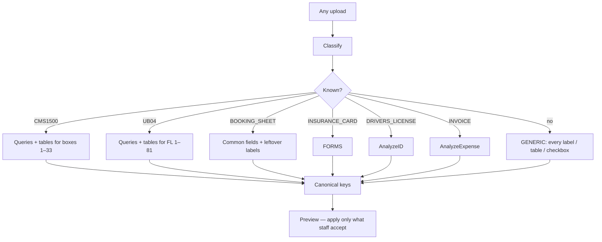

**When a new form shows up** (referral, ABN, EOB, operative note):

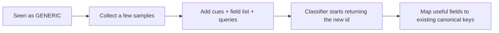

No new capture path. No new apply path. No new database shape. If a change needs any of those, the workflow leaked — fix the workflow, do not special-case the form.

---

## 7. What staff see (same screens, new behavior)

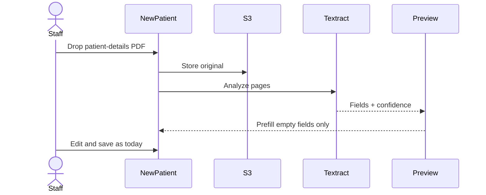

- **New Patient:** the existing “Have a patient details PDF?” control becomes “store + extract + prefill.” Typed values are never overwritten without asking.
- **Documents tab:** upload, status (Extracting / Ready / Needs review), detected form type per segment, Apply to patient / Apply to bundle.
- **Unknown form:** still lists fields. Staff can copy or ignore. Later we promote the layout.

---

## 8. What we are deciding (workflow only)

1. **Textract is the default reader.** It is already in the AWS account, HIPAA-eligible, and matches the insurance sample. A vision model (Bedrock, etc.) is a later overlay if booking-sheet handwriting is weak — not the starting idea.
2. **Classify with registry cues on Textract text**, not a trained Comprehend model, so a new form is a new cue list.
3. **Review in the host platform**, not A2I.
4. **Apply is human.** Extraction never writes the patient or claim by itself.
5. **GENERIC is a first-class outcome**, not a failure.

---

## 9. What it costs

Textract is the new line on the AWS bill. S3, ECS, and RDS are already there. There is no seat fee and no minimum. We pay per **page processed**, once per API call. Sync and async (`StartDocumentAnalysis`) are the same rate. Prices below are the published **US West (Oregon)** list on the [Textract pricing page](https://aws.amazon.com/textract/pricing/), checked 2026-10-27. The same figures are on the current us-east-1 price list. If the project bucket is outside the US, re-check that region before quoting a number.

The first price break is **1,000,000 pages in a month** (100,000 for AnalyzeID). A clinic packet volume sits in the first tier. The cheaper column is here so the sheet is complete.

### 9.1 Rate for each page we send

OCR text is included in every Analyze* response. Adding `LAYOUT` on a call that already has `TABLES` is **$0** ([pricing example 16](https://aws.amazon.com/textract/pricing/)). Pretrained `QUERIES` is a per-page add-on, not a per-question add-on: ten questions on a page cost the same as one. We use pretrained Queries. Custom Queries (the adapter) is a different, higher meter and stays off.

| Page we recognized | Call | First tier | After 1M pages / month |
|---|---|---|---|
| Classify only (title / cue text) | `DetectDocumentText` | $0.0015 | $0.0006 |
| CMS-1500, UB-04 | `AnalyzeDocument` `FORMS` + `TABLES` + `QUERIES` | $0.070 | $0.055 |
| Booking sheet | `FORMS` + `TABLES` (`LAYOUT` included) | $0.065 | $0.050 |
| Insurance card | `FORMS` | $0.050 | $0.040 |
| Letter / unknown | `FORMS` + `LAYOUT` | $0.050, or $0.054 if Layout bills on top of Forms with no Tables — confirm on the first invoice | $0.040 (same caveat, +$0.003) |
| US driver license / passport | `AnalyzeID` (each image is a page; front + back = 2) | $0.025 for the first 100,000 ID pages | $0.010 after 100,000 ID pages |
| Invoice / receipt | `AnalyzeExpense` | $0.010 | $0.008 |

A page is billed again if staff force a re-extract. The file-hash dedupe in §3.1 is what keeps a re-drop off this table.

### 9.2 One packet

The pipeline in §3 is two calls when the upload is a mixed, unlabeled packet: a cheap text pass to pick the form, then one extract call for that class. Staff already labeled the file (Booking sheet, Facility claim, Physician claim) and it is a single form → skip the text pass.

Worked mix from §1, **one page each**, first-tier rates:

| Piece | Classify | Extract | Page total |
|---|---|---|---|
| Booking sheet | $0.0015 | $0.065 | $0.0665 |
| CMS-1500 | $0.0015 | $0.070 | $0.0715 |
| UB-04 | $0.0015 | $0.070 | $0.0715 |
| Insurance card | $0.0015 | $0.050 | $0.0515 |
| **4-page packet** | **$0.006** | **$0.255** | **$0.261** |

Same packet with the text pass skipped (type already known, one form per file): **$0.255**.

A fatter packet — booking sheet 2 pages, UB-04 2 pages, one CMS-1500, one card — is **$0.399** with the classify pass, **$0.390** without it.

### 9.3 What we pay per month, using every service this workflow calls

Each page is charged for **one** reader, the API in §9.1 that matches its type, plus the $0.0015 classify call when the upload is mixed. We do not stack Forms, AnalyzeID, and AnalyzeExpense on the same page.

Services in the monthly number:

| Service | What we pay |
|---|---|
| Textract `DetectDocumentText` | $0.0015 / page, classify pass only |
| Textract `AnalyzeDocument` (Forms, Tables, Queries) | $0.050–$0.070 / page, by the row in §9.1 |
| Textract `AnalyzeID` | $0.025 / ID image |
| Textract `AnalyzeExpense` | $0.010 / invoice page |
| S3 Standard (store the original) | $0.023 / GB-month, $0.005 / 1,000 writes. Under **$1 / month** until stored scans are tens of GB. ([S3 pricing](https://aws.amazon.com/s3/pricing/)) |
| ECS and RDS | Already running for the project. This workflow adds no new instance. |

Two mixes, first-tier rates. **Expected packet** is booking sheet + CMS-1500 + UB-04 + card ($0.261 / 4 pages ≈ **$65 per 1,000 pages**). **Every document type** adds a license, an invoice, and a letter ($0.351 / 7 pages ≈ **$50 per 1,000 pages** — the average drops because AnalyzeID and AnalyzeExpense are cheaper).

| Pages in the month | Monthly, expected packet | Monthly, every document type |
|---|---|---|
| 1,000 | $65 | $50 |
| 4,000 (about 1,000 expected packets) | $261 | $200 |
| 10,000 | $653 | $501 |
| 20,000 | $1,305 | $1,001 |
| 40,000 (about 10,000 expected packets) | $2,610 | $2,003 |

40,000 pages is still the first tier. The 1,000,000-page discount does not show up at this volume. S3 is inside the rounding.

Learning on synthetic PDFs is the same meter. The [free tier](https://aws.amazon.com/textract/pricing/) (100 Analyze Document pages / month for three months) is for **new** AWS accounts. The project's account already exists, so console trials and golden-set runs are billed. One hundred synthetic CMS-1500 pages is about **$7**.

Comprehend, A2I, and Bedrock stay off, so they are **$0** on this bill. Turning them on is a different product: Comprehend entity detection is about $0.0025 / page ([pricing](https://aws.amazon.com/comprehend/pricing/), $0.0001 per 100 characters, ~2,500 characters on a form page), and a custom-classifier endpoint left running all month is about **$1,296** before any page is read ($0.0005 per second). A2I is closed to new customers. Review stays in the host platform's UI.

---

## 10. References

- [Amazon Textract](https://aws.amazon.com/textract/)
- [Textract pricing](https://aws.amazon.com/textract/pricing/) — US West (Oregon) list used in §9
- [Textract getting started](https://docs.aws.amazon.com/textract/latest/dg/getting-started.html)
- [AnalyzeDocument](https://docs.aws.amazon.com/textract/latest/dg/API_AnalyzeDocument.html) — `FORMS`, `TABLES`, `QUERIES`, `LAYOUT`, `SELECTION_ELEMENT`
- [AnalyzeID](https://docs.aws.amazon.com/textract/latest/dg/API_AnalyzeID.html)
- [Insurance IDP Part 1](https://aws.amazon.com/blogs/machine-learning/part-1-intelligent-document-processing-with-aws-ai-services-in-the-insurance-industry/)
- [Insurance IDP Part 2](https://aws.amazon.com/blogs/machine-learning/part-2-intelligent-document-processing-with-aws-ai-and-analytics-services-in-the-insurance-industry/)
- [aws-ai-intelligent-document-processing / industry/insurance](https://github.com/aws-samples/aws-ai-intelligent-document-processing/tree/main/industry/insurance)
- [Workshop: insurance use case](https://catalog.workshops.aws/intelligent-document-processing/en-US/03-industry-use-case/insurance-use-case)
- Isaac Flath [OCR gallery](https://isaacflath.com/building/ocr-examples-gallery) — Textract as the managed-OCR class; evaluate on our packets
